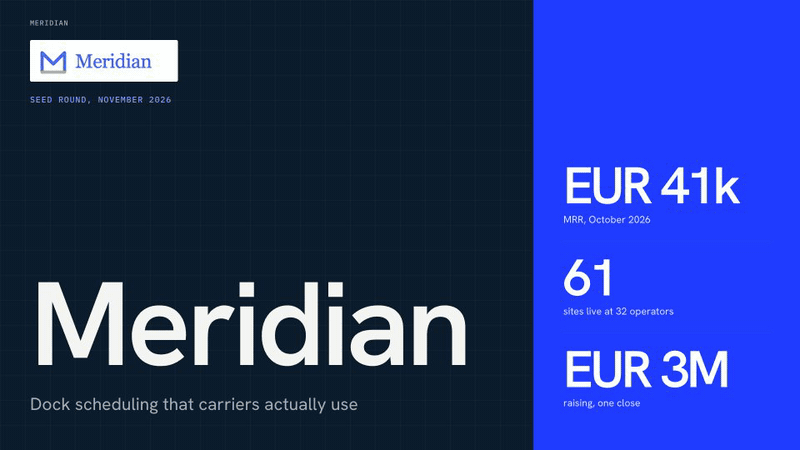

# startup-pitch

An Agent Skill that turns your startup's working folder into an investor pitch you can
defend. Open Claude Code or Codex in the folder, say "help me with my investor pitch", and
in about five minutes you get one page: the questions you must answer first, your pitch in
two sentences and in 60 seconds, the numbers that matter, the five investor questions you
are least ready for, and your top red flags. Then ask for the narrative, the full Q&A, or a
deck as HTML, PDF and PowerPoint.



## Install

```bash
git clone https://github.com/alexandreleciel/startup-pitch-skill.git && cd startup-pitch-skill && ./install.sh
```

Works with Claude Code, Codex CLI, and any agent that reads the open SKILL.md format
(Cursor, Gemini CLI, Copilot CLI, OpenCode, Amp). Nothing is installed system-wide. Other
routes, including the Claude Code plugin marketplace and claude.ai upload, are in
[docs/INSTALL.md](docs/INSTALL.md).

## Use

In your startup's folder:

> Help me with my investor pitch. Everything is in this folder.

Answer the questions it asks, then say what you want next: "write the full narrative",
"prepare the investor Q&A", "build the deck", "prepare me for a corporate VC meeting".
Details in [docs/USAGE.md](docs/USAGE.md).

## Why it is different from asking a model to "write my pitch"

- **It reads first and asks second.** Your folder is inventoried and extracted before any
  question.
- **Every number has a source.** Figures live in `pitch/facts.yaml` as fact, assumption or
  projection, each pointing at the file it came from. A checker recomputes the arithmetic
  (ARR = MRR x 12, runway = cash / burn, use of funds sums to the ask, and more).
- **Contradictions are surfaced, not averaged.** A memo that says 520k and an export that
  implies 494k become a question for you, with the conservative figure used meanwhile.
- **Nothing invented.** No traction, market size, growth, customers or team credentials
  that are not in your folder. Missing figures are visible `[needs number]` slots.
- **Confidential material stays out.** Term sheets, cap tables with names, salaries and
  contracts are not read; deal terms mentioned elsewhere are held back from investor text.
- **A real deck pipeline.** One `deck.json` becomes a self-contained HTML deck, a vector
  PDF and a structure-checked PowerPoint with native charts. Content is checked against each
  layout's capacity before rendering, and every number on a slide is traced to the ledger.
- **440 real pitch decks as reference**, each with round, year, amount, sector and a
  verified link; 25 studied slide by slide (Airbnb 2008 among them). Decks that are not
  public (Higgsfield, for example) are listed as unavailable, not fabricated.

## What you get

```
pitch/
├── START-HERE.md       the one page to read first
├── facts.yaml          every number used, with kind, status and source file
├── narrative.md        on request: purpose sentence, long form, 2-sentence, 60-second, 3-minute
├── investor-qa.md      on request: least-ready five, rapid-fire drill, themed Q&A, red flags
└── deck/               on request
    ├── deck.json       editable source
    ├── deck.html       present in a browser (arrow keys; n for speaker notes)
    ├── deck.pdf        one page per slide
    └── deck.pptx       native PowerPoint, editable text and charts
```

A complete example for a fictional company is in
[examples/sample-output](examples/sample-output).

## Requirements

Python 3.10+ for the start page, narrative and Q&A. Node 18+ and Chrome or Edge for the
deck. `install.sh` sets up the rest inside the skill folder; `pitch.py doctor` shows what is
available and what each missing piece unlocks.

## Repository layout

| Path | What |
|---|---|
| `install.sh` | one-step install for Claude Code and Codex |
| `skills/startup-pitch/SKILL.md` | the skill: rules and workflow (about 140 lines) |
| `skills/startup-pitch/references/` | `core.md` (read on every run) plus on-demand files: narrative, investor questions, question bank, meetings, red flags, investor types, metrics, benchmarks, deck structure, design, deck library |
| `skills/startup-pitch/scripts/pitch.py` | one entry point: `intake`, `check`, `deck`, `comparables`, `status`, `setup`, `doctor` |
| `skills/startup-pitch/scripts/` | the scripts behind it: inventory, extract, ledger check, deck builder, PDF export, library search and verification |
| `skills/startup-pitch/assets/library/` | `pitch-decks.csv` (440 rows), `unavailable.csv`, collection and verification notes |
| `skills/startup-pitch/assets/deck-template/` | four themes, example deck, previews |
| `skills/startup-pitch/evals/` | three test cases in the `claude plugin eval` layout |
| `examples/` | three fictional startup folders with an answer key, and a sample output |
| `docs/` | INSTALL, USAGE, ARCHITECTURE, TESTING, UPSTREAM-SOURCES, PROMISES, evidence |
| `tests/`, `tools/` | trap grader, repository lint, owner-placeholder script |

## What is tested and what is not

[docs/TESTING.md](docs/TESTING.md) has the runs and numbers;
[docs/PROMISES.md](docs/PROMISES.md) says, claim by claim, what the evidence supports.
In short: three fictional startups with planted traps, compared against a plain prompt;
quick runs of five to nine minutes passing every trap check; a founder-answers-then-deck
round; live Codex CLI runs including automatic triggering from a plain request. Not tested:
PowerPoint or Keynote rendering of the PPTX (LibreOffice only), Windows and Linux,
claude.ai upload, automatic triggering in Claude Code, and any real fundraising outcome.

## Credits and license

This skill integrates and re-synthesises work by many people. The inventory of upstream
skills, repositories, canonical articles and data sources is in
[docs/UPSTREAM-SOURCES.md](docs/UPSTREAM-SOURCES.md).

Released under the [MIT License](LICENSE). Copyright (c) 2026 Alexandre Leciel. The deck
library is an index of links to publicly available decks; the decks themselves belong to
their owners and are not redistributed here.
