# Deck pipeline

`pitch/deck/deck.json` is the single editable source. One Node script turns it into a
self-contained `deck.html` and a `deck.pptx`; one shell script prints the HTML to a PDF.
Everything else (art direction, tones, layouts, charts, diagrams, icons, speaker notes,
the sources slide) is derived.

```
deck.json  --build_deck.js-->  deck.html  (present in any browser; arrows, click, swipe; n = notes)
                          \->  deck.pptx  (faithful: every slide a 2x picture; or editable; or none)
deck.html  --export_pdf.sh-->  deck.pdf   (Chrome headless print, one page per slide, vector text)
deck.html  --build_deck.js --check-->  qa/slide-NN.png + qa/report.json  (render checks)
```

Preview of the example deck in the `ledger` theme (`example-deck.json`):

| | | |
|---|---|---|
| 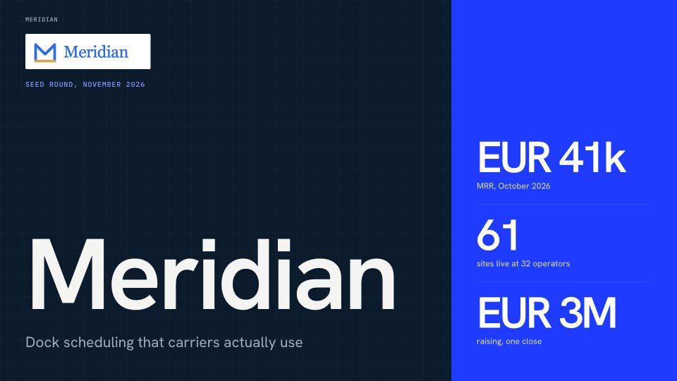 | 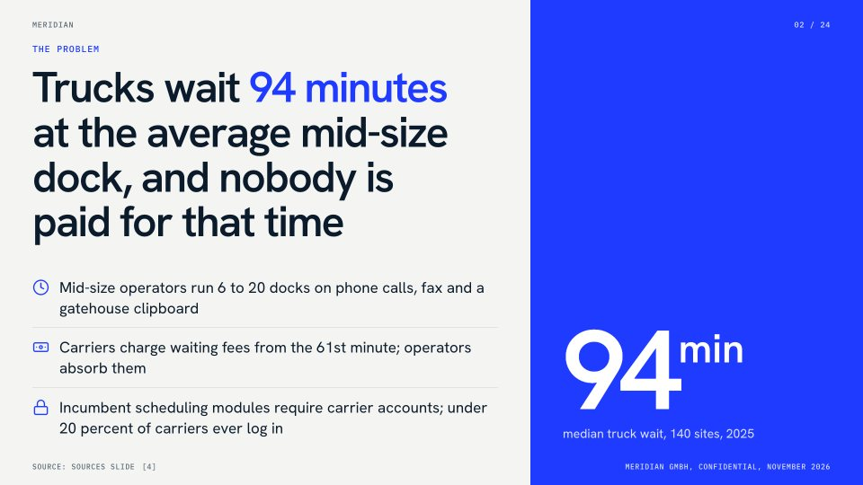 | 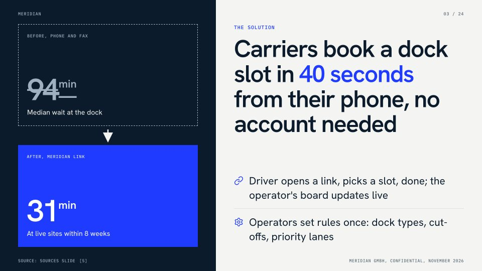 |
| 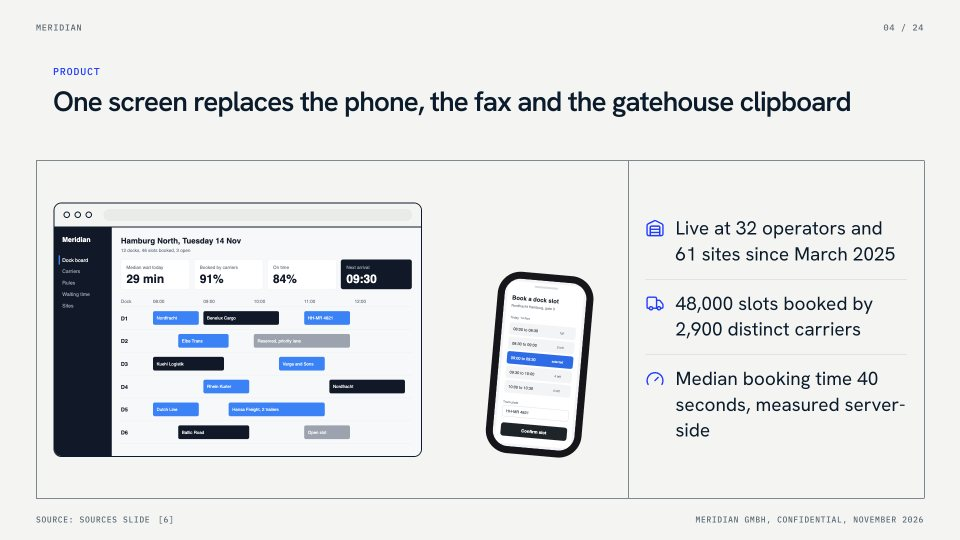 | 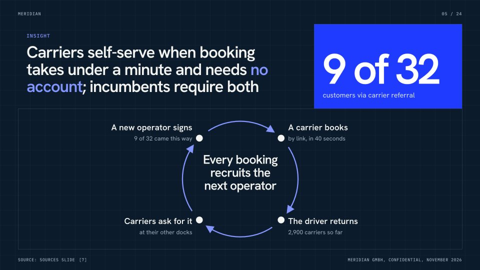 | 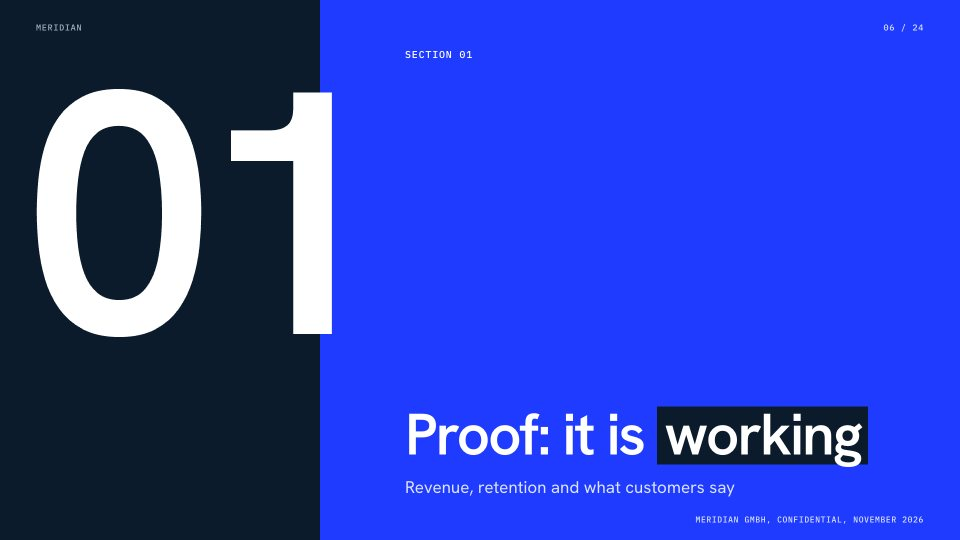 |
| 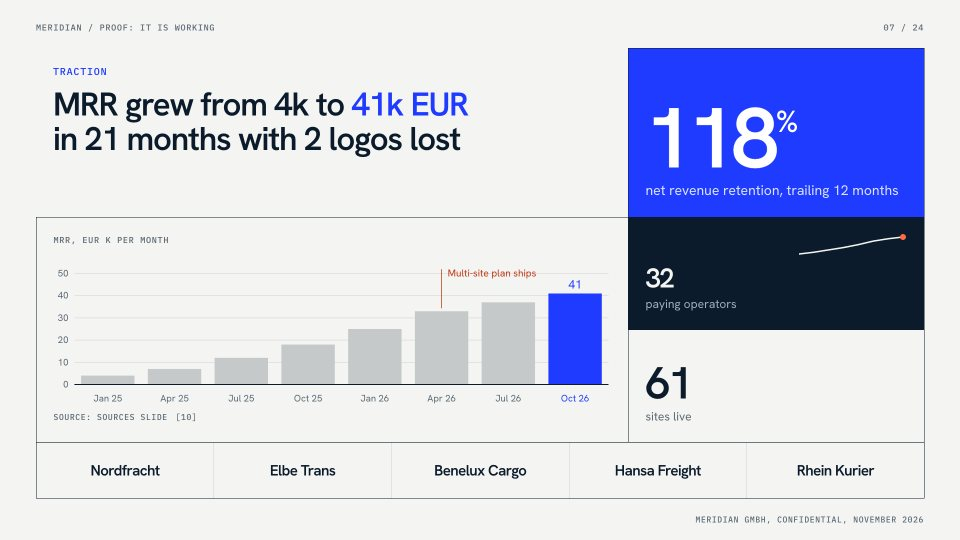 | 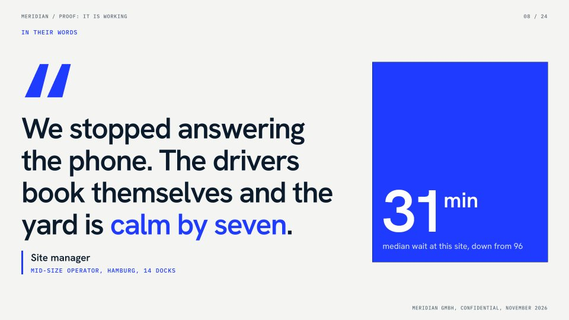 | 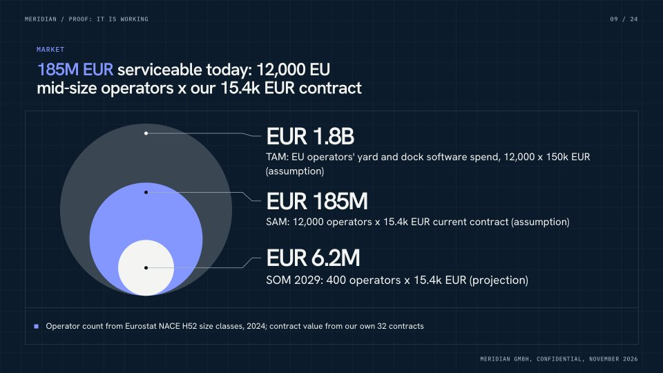 |
| 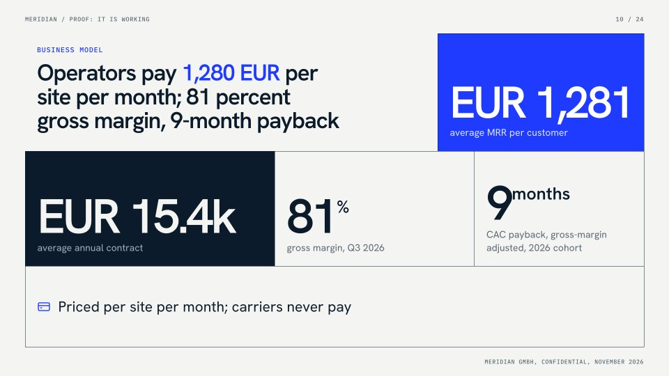 | 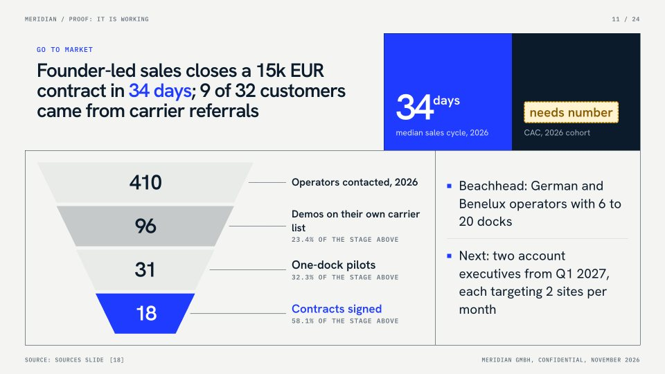 | 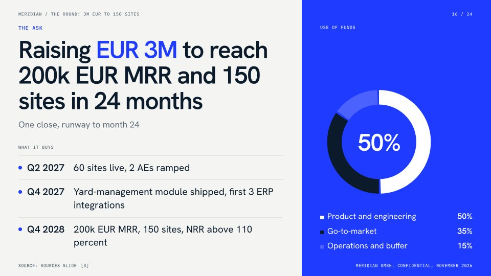 |

## Commands

The usual way to run all of this is one command from the startup folder, `python3 scripts/pitch.py deck`: build, PDF, QA screenshots, number tracing and one summary. The individual commands below are what it calls.

```bash
# once per machine
scripts/check_env.sh                                   # what is installed, what each missing item unlocks
npm install --prefix scripts                           # pptxgenjs 4.0.1 and playwright-core (drives the installed Chrome for --check; no browser download)

# per deck
node scripts/build_deck.js pitch/deck/deck.json              # deck.html + deck.pptx next to the JSON
node scripts/build_deck.js pitch/deck/deck.json --html-only
node scripts/build_deck.js pitch/deck/deck.json --pptx editable   # native text and charts instead of pictures (also: faithful, none)
node scripts/build_deck.js pitch/deck/deck.json --out build/ # write elsewhere
node scripts/build_deck.js pitch/deck/deck.json --check      # also screenshot every slide to deck/qa/
node scripts/build_deck.js pitch/deck/deck.json --strict     # fail the build on any capacity warning
node scripts/build_deck.js --capacities                      # print the capacity table (what fits per slide type)
node scripts/build_deck.js pitch/deck/deck.json --facts pitch/facts.yaml   # ledger for the sources slide (auto-detected at pitch/facts.yaml)
scripts/export_pdf.sh pitch/deck/deck.html [deck.pdf]        # PDF, verifies page count == slide count
```

Try it on the example: copy `example-deck.json` and the `assets/` folder next to it into a
scratch directory as `deck.json`, then run the three commands above.

## Capacity lint

The renderer and the lint are one pass. Every slide is composed of cells of known size, and
every text is wrapped in the deck's own fonts before any HTML is written: headlines, points
and numerals step down a size ladder until they fit, and whatever still does not fit is
reported with the slide number and what to do, for example "slide 7 (traction): a stat cell
is overfull by about 16 percent. Shorten the stat label." Warnings do not stop the build
unless `--strict` is set. The ladders also run upward: tables, lists, diagram labels and
milestone rows grow to use their cell, and a list, table or diagram cell that still stays
under 55 percent filled is listed under `slack:` (and in `qa/report.json`), so a thin slide
is named instead of shipped. Glyph widths of every theme face are in `font-metrics.json`
(regenerate with `--measure-fonts` after changing a theme); a deck that sets `font_display`
or `font_body` is measured in the installed Chrome at build time. `--capacities` prints the
table of what fits per slide type (`references/deck-structure.md` section 4); it is found
by rendering each form with one field growing until the lint objects. Decks at those limits
render with 0 QA issues in all nine themes and both variants, so a deck with no warnings
should not need a second build.

`--check` screenshots every slide and reports what the browser shows: text that leaves the
stage, the content frame or its cell, clipped or overlapping text, type below the size
floor (24 px for running text on the 1920 px stage, 22 px in the read variant, 16 px for
labels and captions), and text contrast under 4.5:1 against the ground it sits on.

## PPTX modes and checks

`meta.pptx` (or `--pptx`) picks the PowerPoint output; the file is always `deck.pptx`.

- `faithful` (default): every slide is a full-bleed picture rendered by Chrome at twice the
  stage size, with the speaker notes and a title per slide for the outline. It is
  the PDF as pictures and the text is not editable. Flat slides are stored as PNG, slides
  with gradients as JPEG. The grain texture is left out of these pictures because noise at
  3840 px would triple the file size (`PITCH_PPTX_GRAIN=1` keeps it).
- `editable`: one picture per slide of the ground, cells, diagrams, icons and images, with
  every text as a native text box at its measured position and charts as native charts.
  Bar, line and area charts are native; donuts, diagrams and icons are part of the picture.
  Fonts fall back to safe ones (Georgia for headlines when the display face is a serif;
  `meta.pptx_font_display` and `meta.pptx_font_body` name others), so lines can break
  differently: look at it once.
- `none`: no PPTX.

Both need Chrome and playwright-core. Without them the build says so and writes the native
PPTX instead (shapes, charts and tables drawn by pptxgenjs in the theme's base tone,
simpler layouts, fully editable).

After writing `deck.pptx` the builder always runs `scripts/pptx_check.py`, a structural
check that needs only the Python standard library: the archive is intact, every XML part
is well formed, the slide list matches the slide parts, every relationship resolves, every
part has a content type, and colours are six hex digits. It prints
`pptx_check (exit 0): archive, XML, slide list, relationships, content types and colours all OK`.
When Anthropic's pptx skill is installed on the machine (for example under
`~/.claude/skills/`), its OOXML validator is found and run as a second check and prints
`validate.py (exit 0): All validations PASSED!`; it needs `lxml` and `defusedxml`. This
skill does not contain that validator, and nothing has to be installed for the default
check. Set `PITCH_PPTX_VALIDATOR=/path/to/validate.py` to point at a copy elsewhere.
A failing check sets the build's exit code to 1.

## Editing

**deck.json** is the normal path. `references/deck-structure.md` is the field reference
(section 3: every field, the diagram kinds, the icon names; section 4: what fits) and
`references/file-formats.md` the file contract. Rebuild after every edit.

- Slide types: `cover`, `problem`, `solution`, `product`, `insight`, `market`, `traction`,
  `business_model`, `go_to_market`, `competition`, `team`, `financials`, `ask`, `roadmap`,
  `closing`, `appendix`, `case_study`, `quote`, `section`, `statement`, `two_column`,
  `custom_html`, and the generated `sources`.
- Layouts follow the content: stats make a mosaic with the first stat in the accent cell;
  problem, solution and ask are colour-block splits; cover, section, statement, quote and
  closing are full-bleed. Each slide has a tone (`light`, `dark`, `accent`), assigned
  automatically so no more than three in a row share one.
- Visual vocabulary, all from deck.json: `diagram` (`flow`, `funnel`, `timeline`, `market`,
  `matrix`, `power_grid`, `loop`, `layers`, `before_after`), `icon` on points and steps,
  `frame` around images (`browser`, `phone`), `logos[]`, `sparklines[]`, charts with a
  highlighted latest value, direct labels and one `annotation`, `donut` for use of funds,
  one emphasised phrase per title between asterisks.
- `[needs number]`, as a whole value or inside a sentence, renders as a dashed amber slot
  and is listed in the build log. It never looks final.
- Content slides never show a raw ledger id. A caption reads "Source: data/metrics.csv"
  (the ledger entry's source file); without a `facts.yaml` it shows a reference number
  that resolves on the sources slide. Stat-level sources appear only in the `read` variant.
- The sources appendix is generated from every `source` reference: compact by default (one
  row per source file), `meta.sources: "full"` for one row per ledger id, `"none"` for no
  appendix.

**deck.html** can be hand-edited for a one-off tweak, but the next build overwrites it.
For a layout none of the types or diagrams covers, use a `custom_html` slide.

## Themes, fonts and icons

Nine art directions live in `themes.css`; `THEMES.md` says when to pick which and what a
theme controls. Web fonts load from Google Fonts with `display=swap` and fall back to
local faces offline. `icons.json` is a subset of 74 Lucide icons (lucide-static 1.71.0,
ISC license), inlined as SVG where a slide uses one.

## Presenting

Open `deck.html` in any browser. The 1920x1080 stage scales to the window. Keys: arrows,
space, PageUp/PageDown, Home, End; click the right two thirds for next, left third for
previous; swipe on touch screens; `n` toggles the speaker notes overlay (question plus
notes). The URL hash tracks the slide, so `deck.html#7` opens slide 7. `?print` lays all
slides out in sequence without scaling (what the PDF printer sees); `?noscale` keeps the
viewer interactive at 1:1 (what `--check` screenshots).

## Known limitations

- The faithful PPTX is pictures: nobody can edit a typo in PowerPoint. Rebuild from
  deck.json, or use `--pptx editable`.
- The editable PPTX sets text in safe fonts at the positions measured in the browser. It
  is close, not identical: a line can break differently, gradient fills under lines are not carried over, and diagrams, icons and the grain are part of the
  picture, not shapes. Open it once in PowerPoint before sending.
- `custom_html` is not measured by the lint and stays a picture in both PPTX modes.
- Hand edits to `deck.html` are lost on rebuild unless they live in a `custom_html` slide.
- Offline, the fallback fonts change line breaks. `--check` says when it measured fallback
  fonts; trust a clean result only when the log shows the web fonts loaded.
- Photos are not processed: team photos are shown in greyscale through CSS, logo files as
  given (a strip of logos reads best with single-colour SVGs).
- A matrix places labels beside their dots without resolving collisions between two
  competitors that sit close together; move one of them slightly.
- The builder does not read the ledger to verify numbers; it only decorates captions and
  the sources slide and warns about unknown ids. `scripts/ledger_check.py` is the authority.
- No PowerPoint or Keynote is used in the test loop; PPTX QA relies on the structural
  check, Anthropic's validator where it is installed, and a LibreOffice render.

## Dependencies and versions tested

| Item | Version tested | Needed for |
|---|---|---|
| Node | 26.13.0 (18 or newer works) | build_deck.js |
| pptxgenjs | 4.0.1 | deck.pptx |
| playwright-core | 1.65.0 | faithful and editable PPTX, `--check`, font measurement, PDF fallback route |
| Google Chrome | 157.0.8103.50 | PDF print, PPTX pictures, screenshots (Edge or Chromium also work) |
| Python | 3.14 and 3.15 | pptx_check.py (standard library only) |
| lxml, defusedxml | 6.1.3, 0.7.1 | only for Anthropic's validator, when their pptx skill is installed |
| LibreOffice | 26.8.2.2 | PPTX preview render, PDF fallback from PPTX |
| poppler (pdfinfo, pdftoppm) | 26.11.0 | page-count check, PPTX preview images |
